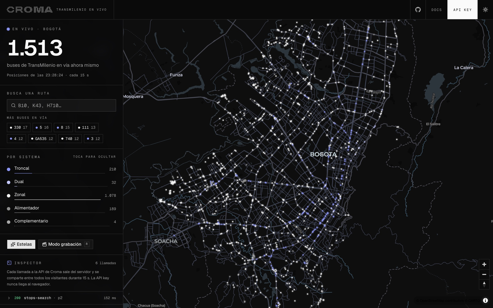

<div align="center">

<picture>
  <source media="(prefers-color-scheme: dark)" srcset="public/croma_brand_white.svg">
  
</picture>

# TransMilenio en vivo

**Every bus in Bogotá, moving on one map, right now.**

A live map of Bogotá's public transport built on the [Croma API](https://docs.usecroma.com/guides/colombia/transmilenio): the whole TransMilenio fleet gliding across the city, the next buses at any station, and the path of any route, from four endpoints and one API key.

**[Open the live map →](https://transmi.usecroma.com)**

[](https://vercel.com/new/clone?project-name=transmilenio-live&repository-name=transmilenio-live&repository-url=https%3A%2F%2Fgithub.com%2Fcroma-labs%2Ftransmilenio-live&env=CROMA_API_KEY&envDescription=CROMA_API_KEY+reads+TransMilenio+through+Croma+%28free+to+get%29.&envLink=https%3A%2F%2Fplatform.usecroma.com%2Fsign-up)
&nbsp;
[](https://platform.usecroma.com/sign-up)

<br />



</div>

---

## What's inside

- **The whole fleet, live**: every bus on the network, from about 1,500 late at night to close to 8,000 at rush hour, read from `vehicles` and drawn on the map. A new snapshot lands every 15 seconds and each bus glides from its last reported position to the new one instead of jumping.
- **Trails**: the last six positions of each bus, so the city's corridors draw themselves as the fleet moves.
- **Any route**: type a code (`L18`, `B10`, `H710`) and its buses light up while the rest of the fleet dims. The route's path comes from `route` with `include_geometry`, and the map flies to it.
- **Any station**: click one for the next buses from `stop-arrivals`, with minutes away and how late or early each one runs, refreshed every 20 seconds.
- **Any bus**: click one for its route, the stop it is heading to, its plate and its last report. **Seguir bus** keeps the camera on it as it moves.
- **Time slider**: switch to **Horario programado** and drag through the day, or press play to watch it run at two minutes a second. Every bus is placed where TransMilenio's published timetable says it should be at that minute, on weekdays, Saturdays or Sundays and holidays. It is labeled as the timetable, never as live, and it keeps working when the live feed stops.
- **Recording mode**: press `R`. The panels go, the camera tilts and turns slowly over the city, and a large live counter takes the corner. Built for screen recordings and social posts.
- **A live API inspector**: every call the server makes, its status and latency, and a ready-to-run cURL.
- **One snapshot for everyone**: the server reads the fleet once every 15 seconds and every visitor shares it, so the API is called the same number of times whether one person watches or a thousand. The API key never reaches the browser.
- **Validated end to end**: Zod checks every query parameter before it reaches the API and every API response before it reaches the map.
- **Crafted UI**: [shadcn/ui](https://ui.shadcn.com) on the same ruled-sheet design system as the [Croma Chat Template](https://github.com/croma-labs/croma-chat-template): hairline rails, mono eyebrow labels, square surfaces, Croma blue. The map is [MapLibre](https://maplibre.org) on CARTO basemaps, in dark and light, on desktop and mobile.

## One-click deploy

1. Click **Deploy with Vercel** above.
2. Grab a free API key with the **Get your Croma API key** button (sign-up takes a minute).
3. Paste your `CROMA_API_KEY` when Vercel asks for env vars.
4. Done. Your map is live.

## Running locally

```bash
git clone https://github.com/croma-labs/transmilenio-live
cd transmilenio-live
npm install

cp .env.example .env.local
# fill in CROMA_API_KEY

npm run dev
```

Open [http://localhost:3000](http://localhost:3000), type `L18` in the route search, then press `R`.

## Environment variables

| Variable                   | Required | Description                                                                              |
| -------------------------- | -------- | ---------------------------------------------------------------------------------------- |
| `CROMA_API_KEY`            | ✅       | Reads TransMilenio through Croma. [Get one free →](https://platform.usecroma.com/sign-up) |
| `CROMA_API_URL`            | optional | API base override. Defaults to `https://api.croma.run`.                                  |
| `UPSTASH_REDIS_REST_URL`   | optional | Limits station and route lookups per IP. [Upstash Console →](https://console.upstash.com/) |
| `UPSTASH_REDIS_REST_TOKEN` | optional | Pairs with the URL above.                                                                |

## How it works

```
app/api/fleet/route.ts       The shared fleet snapshot (every page of vehicles, merged)
app/api/stations/route.ts    The stations on the map, kept for six hours
app/api/arrivals/route.ts    The next buses at one station
app/api/route/route.ts       One route's path and stops
app/api/schedule/route.ts    Every bus at one minute of the published timetable
lib/schedule.ts              Reads the compiled timetable and places each trip between its stops
scripts/build-timetable.ts   Compiles TransMilenio's GTFS.zip into data/timetable
lib/transit.ts               The calls to Croma, and the snapshots every visitor shares
lib/croma.ts                 POST to Croma, validate with Zod, record a trace for the inspector
lib/schemas.ts               Zod schemas for every response and query parameter
components/bus-map.tsx       The map: layers, the glide between snapshots, trails, clicks, camera
components/live-app.tsx      Page state: route focus, selection, recording mode, mobile layout
components/panels.tsx        Live counter, route search, legend, bus card, inspector
components/station-sheet.tsx Next buses at a station
```

Every 15 seconds:

1. The browser asks `/api/fleet`. If this server read the fleet in the last 15 seconds, every visitor gets that same snapshot; a request already in flight is joined, not repeated.
2. Otherwise the server reads page 1 of `POST /co/transmilenio/vehicles/v1` (500 buses a page), then every other page in parallel, and merges them into one compact list, with each route's code, name and system listed once.
3. The map starts a glide from where every bus is drawn now to its new position, and appends that position to the bus's trail.

The calls behind it:

| Endpoint                                 | Used for                                       |
| ---------------------------------------- | ---------------------------------------------- |
| `POST /co/transmilenio/vehicles/v1`      | Every bus on the network, 500 per page         |
| `POST /co/transmilenio/stops-search/v1`  | The stations on the map, with `kind: "station"` |
| `POST /co/transmilenio/stop-arrivals/v1` | The next buses at a station                    |
| `POST /co/transmilenio/route/v1`         | A route's path, with `include_geometry: true`  |

```bash
curl https://api.croma.run/co/transmilenio/vehicles/v1 \
  -H "Authorization: Bearer $CROMA_API_KEY" \
  -H "Content-Type: application/json" \
  -d '{"route": "L18"}'
```

### The timetable

The time slider does not call the API. `npm run timetable` downloads TransMilenio's public GTFS feed (`GTFS.zip`, about 190 MB, nine million stop times) and compiles it into `data/timetable`: one gzipped binary per day type with each trip's route, its stops and the seconds between them, plus a `meta.json` with routes, stops and the holidays that run Sunday's timetable. That is about 15 MB, committed so a deploy needs no build step. Rebuild it when TransMilenio publishes a new timetable.

`/api/schedule?minute=450&day=weekday` loads the day once per server instance, then for each trip running at that minute finds the two stops it is scheduled between and places the bus on the straight line between them. Trips that run past midnight count for the early hours. Answers are cached for an hour, since the timetable is the same every week. TransMiCable cabins, which the feed lists by frequency instead of by trip, are left out.

## Customization

- **Refresh rate**: the snapshot lifetime in `lib/transit.ts` and the poll in `components/live-app.tsx`. The network itself refreshes positions about every 20 seconds, so faster polling only repeats the same positions.
- **Colors and labels per system**: `lib/systems.ts`.
- **The glide, trails and camera**: `GLIDE_MS`, `TRAIL_POINTS` and the recording-mode orbit in `components/bus-map.tsx`.
- **Basemap**: the two style URLs at the top of `components/bus-map.tsx`. Any MapLibre style works.
- **Look & feel**: design tokens in `app/globals.css` (`--line` hairlines, `--agent` accent, square radius; shadcn/Tailwind v4).

## Production notes

- The fleet is never rate limited: it is one shared snapshot, so traffic does not change how often the API is called. Station and route lookups each cost a call, so with Upstash set they are limited to 60 per 10 minutes per IP.
- The snapshot lives in each server instance's memory. On Vercel's Fluid Compute instances are reused, so a busy deploy still reads the fleet about once every 15 seconds per instance.
- Polling pauses while the tab is hidden and resumes the moment it is visible again.
- Arrivals are estimated from the last stop each bus reported plus the scheduled running time from there; each one says whether it is `estimated` or `predicted`.

## Learn more

- [TransMilenio on Croma](https://docs.usecroma.com/guides/colombia/transmilenio): all eight endpoints, schedule and live, with schemas
- [Croma docs](https://docs.usecroma.com): every source, with schemas
- [Croma MCP](https://platform.usecroma.com/mcp): ask Claude, ChatGPT or Cursor when the next bus comes
- [Croma Chat Template](https://github.com/croma-labs/croma-chat-template) · [DIAN Playground](https://github.com/croma-labs/dian-facturacion-example)

## License

[MIT](LICENSE). Transit data from TransMilenio S.A. via Croma. Basemap © [CARTO](https://carto.com/attributions), © [OpenStreetMap](https://www.openstreetmap.org/copyright) contributors.
